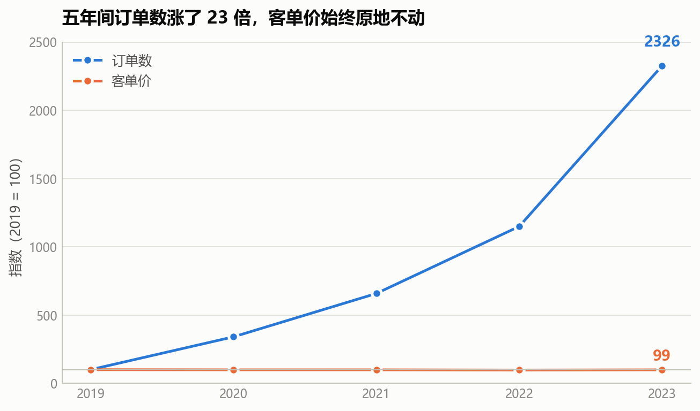
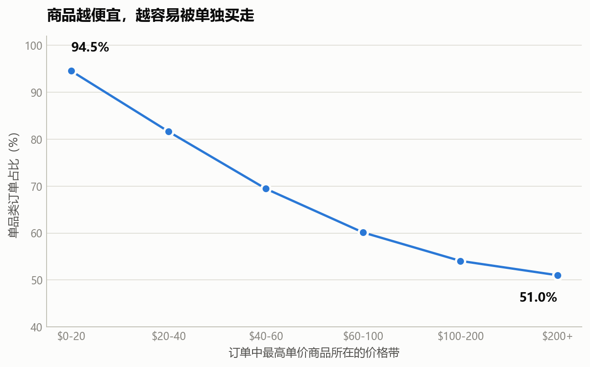
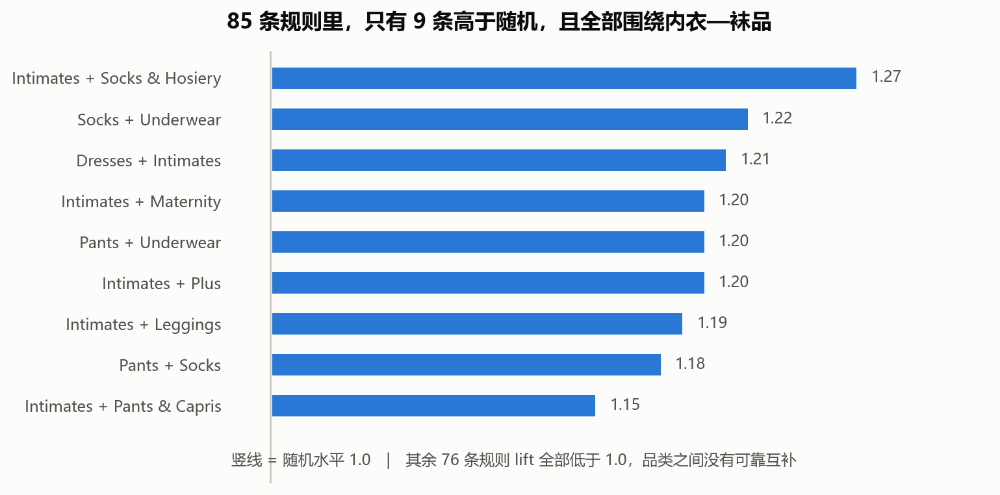

# TheLook 服饰电商增长质量诊断

> 用 12.5 万笔订单诊断一家美式服饰电商的增长质量问题：订单量五年涨了 23 倍，客单价却始终停在 $86。



---

## 一句话结论

**这五年的增长，100% 来自"卖出更多单"，0% 来自"每单卖得更值钱"。**

对数分解显示：订单数对收入增长的贡献是 **100.4%**，客单价贡献 **−0.4%**。客单价五年均值 $86.66、标准差 $0.93，变异系数只有 **1.07%**。

问题出在连带上——**71.5% 的订单只买一个品类**，而每多买一个品类，客单价几乎翻倍。

| 订单内品类数 | 订单数 | 占比 | 客单价 |
|---|---:|---:|---:|
| 1 | 89,500 | **71.5%** | $60.98 |
| 2 | 24,526 | 19.6% | $122.00 |
| 3 | 7,046 | 5.6% | $194.00 |
| 4 | 4,154 | 3.3% | $243.23 |

而且价格越便宜越容易单买：$0–20 商品的单品类率达到 **94.5%**，$200+ 只有 51.0%。



---

## 做了什么

| 步骤 | 方法 | 结论 |
|---|---|---|
| 1. 增长归因 | 对数分解 `ln(收入) = ln(订单数) + ln(客单价)` | 订单数贡献 100.4%，客单价 −0.4% |
| 2. 篮筐诊断 | 分组统计 + Kruskal-Wallis | 篮筐宽度是客单价强驱动（ε² = 0.294，大效应） |
| 3. 价格带交叉 | 卡方检验 + Cramér's V | 越便宜越容易单买（χ² = 13,769，V = 0.191） |
| 4. 目标池细分 | 按客单价分档 | 目标池 53,943 单 / 排除池 10,271 单 |
| 5. 关联规则 | Apriori 思路 + lift | 85 条规则，只有 9 条高于随机 |
| 6. 样本外验证 | 2019–22 训练 → 23 检验 | Top10 规则 10/10 保留，r = 0.956 |
| 7. 情景测算 | 两种口径 + 敏感性分析 | 转化 10% → +$100,008（+0.92%） |



---

## 踩过的坑（这部分可能比结论更有价值）

分析过程中证伪了五个看似合理的方向，原因都是**数据没有方差**：

| 方向 | 证据 |
|---|---|
| 物流时效 / 选址 | 距离 vs 在途时长 **r = −0.0008**（n = 63,841） |
| 退货归因 / 预测 | 退货率 10.03%，26 个品类全在 9.3%–11.3% |
| 库存周转 | 26 个品类售出率全为 36.9%–37.2%，库龄全约 30 天 |
| SKU 长尾治理 | 砍掉最低收入 50% SKU：损失 16.6% 收入、释放 17.0% 成本，1:1 无净收益 |
| 人群定向 | 目标池用户与全站几乎重合（41.1 岁 vs 41.1 岁） |

还有两个方法论错误，已经犯过并修正：

- **自选择偏差**：不能拿"双品类客单价 $122 − 单品类 $60.98"当干预收益。修正后增量从 $61 降到 $18.54，收入测算从 **+5.6% 下调到 +0.9%**。
- **关联规则分母**：lift 的分母基数必须遍历全部订单。只在多品类订单里统计会让 lift 放大 3.5 倍。

> 这个数据集的真相是：它是 Looker 发布的**公开合成数据**。注册量五年恒定、邮箱全是 `example.com` 这类示例域名、用户 ID 严格从 1 到 100000 连续无缺号。所以本项目的定位是「在给定数据条件下做一次可复现的量化诊断」，结论只适用于这份数据本身。

---

## 目录结构

```
thelook-growth-diagnosis/
├── TheLook_业务场景分析.md      主报告（11 章 + 附录，代码内联）
├── TheLook_业务场景分析.ipynb   同上，可执行版本
├── scripts/
│   ├── 01_data_check.py         数据体检与审计
│   ├── 02_growth_basket.py      增长归因、篮筐诊断、目标池
│   ├── 03_rules_validate.py     关联规则、样本外验证、情景测算
│   ├── 04_figures.py            生成 6 张图表
│   ├── 05_verify_numbers.py     复核正文所有数字
│   ├── 06_test_snippets.py      把正文代码块原样跑一遍
│   └── 07_md_to_ipynb.py        md → ipynb
└── outputs/
    ├── 01–03_*.txt              三个阶段的运行结果
    └── figures/                 fig1–fig6
```

---

## 数据

**数据未包含在本仓库中**（`events.csv` 单文件就有 376 MB，超出 GitHub 限制）。获取方式二选一：

**方式一：BigQuery 公共数据集（推荐，数据最新）**

```sql
SELECT * FROM `bigquery-public-data.thelook_ecommerce.orders`;
```

七张表都在 `bigquery-public-data.thelook_ecommerce` 下，免费额度每月 1 TB。

**方式二：Kaggle 下载**

```bash
curl -L -o dataset.zip \
  "https://www.kaggle.com/api/v1/datasets/download/mustafakeser4/looker-ecommerce-bigquery-dataset"
unzip dataset.zip -d data/
```

下载后把七个 CSV 放进 `data/` 目录即可。脚本会自动定位（用 `glob("**/data")`，不依赖固定路径）。

---

## 运行

```bash
pip install -r requirements.txt

python scripts/01_data_check.py        # 数据体检
python scripts/02_growth_basket.py     # 增长归因 + 篮筐诊断
python scripts/03_rules_validate.py    # 关联规则 + 验证 + 测算
python scripts/04_figures.py           # 生成图表
python scripts/07_md_to_ipynb.py --run # 重新生成并执行 Notebook
```

也可以直接打开 `TheLook_业务场景分析.ipynb` 逐格执行——它和 md 内容逐字一致。

---

## 技术栈

Python 3.13 · pandas · numpy · scipy（Kruskal-Wallis / 卡方）· matplotlib · Jupyter

分析中没有使用任何机器学习模型——因为数据不具备可建模的方差，硬上模型只会得到 AUC ≈ 0.5 的结果。这一点在报告第三部分有完整说明。
