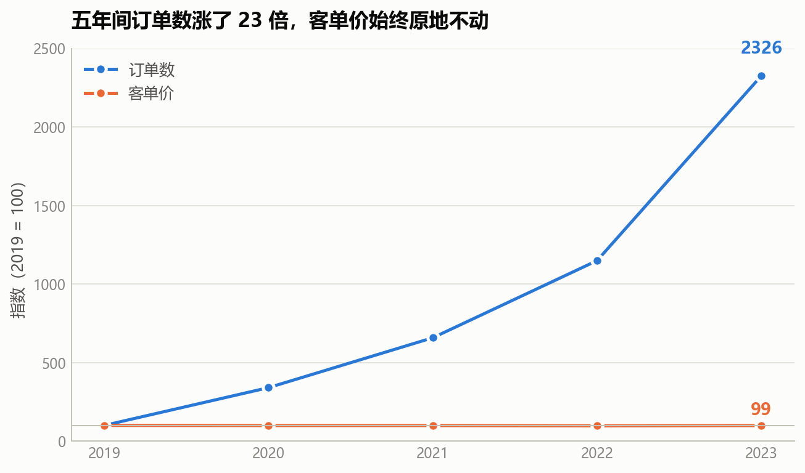
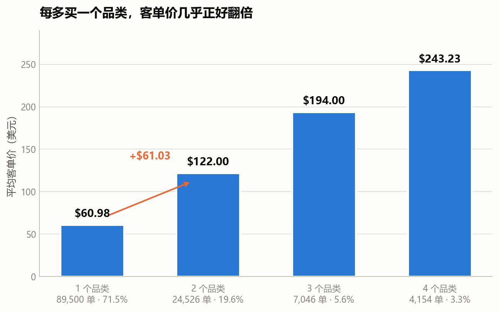
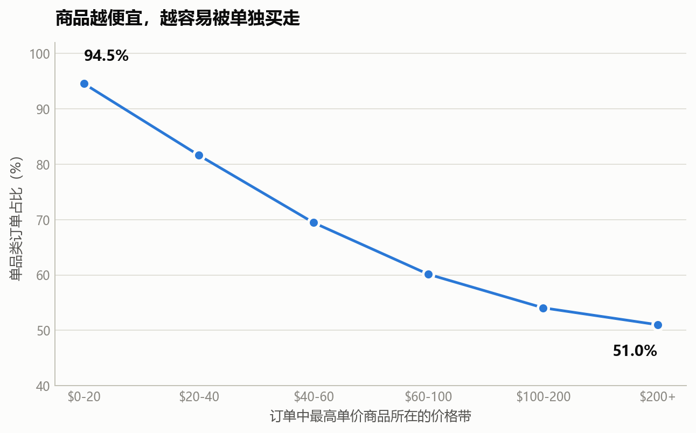
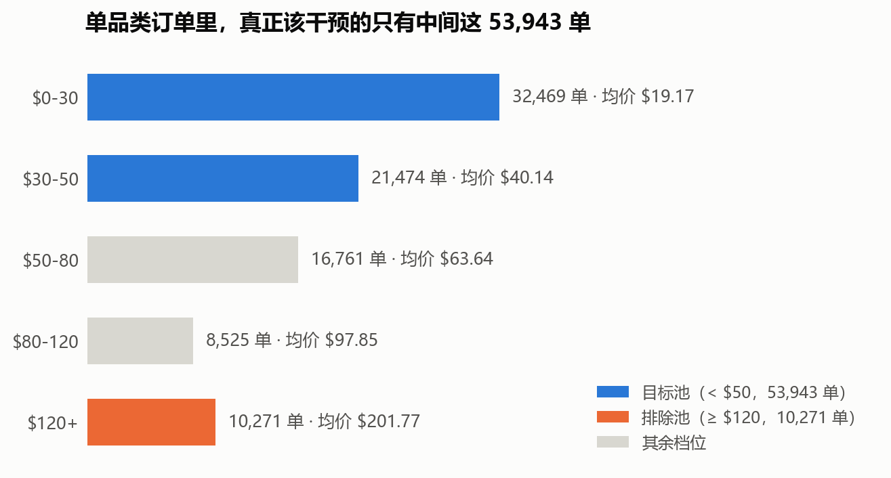
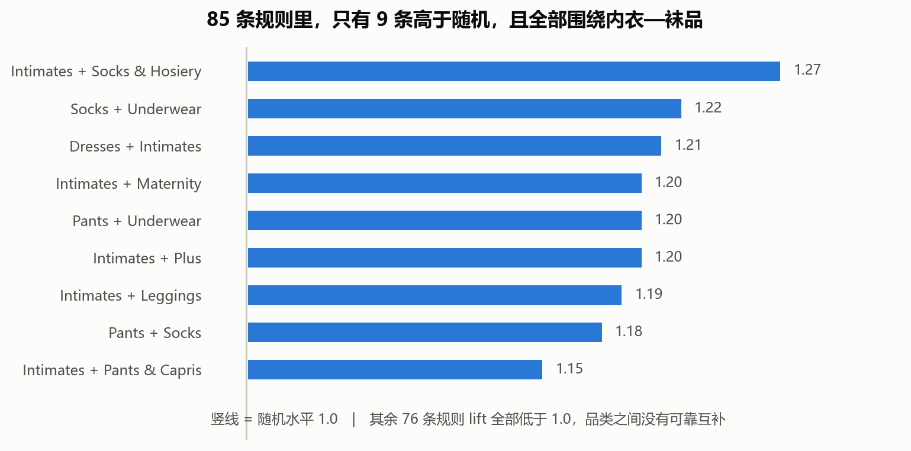
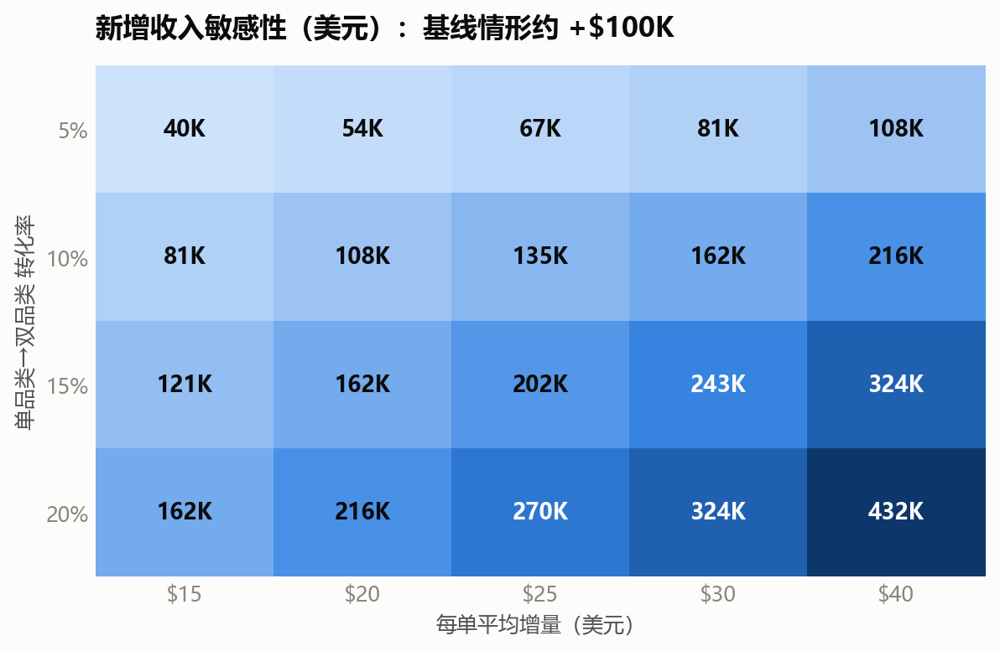

# TheLook 服饰电商增长质量诊断

| 项目 | 说明 |
|---|---|
| 数据 | Looker 公开数据集 TheLook（`bigquery-public-data.thelook_ecommerce`） |
| 规模 | 125,226 笔订单 / 181,759 条订单明细 / 29,120 个 SKU / 100,000 名用户 |
| 核心发现 | 五年订单量涨 23 倍，客单价停在 $86；71.5% 的订单只买一个品类 |
| 完成日期 | 2026-11-01 |

---

## 摘要

本报告基于 TheLook 的 125,226 笔订单，诊断这家服饰电商过去五年的增长质量。三条结论：

一是增长完全由订单数驱动。2019 到 2023 年订单量涨了 23.3 倍，客单价从 $87.79 变成 $86.74，对数分解下客单价对增长的贡献是 −0.4%。

二是卡点在连带。71.5% 的订单只买一个品类，单品类订单客单价 $60.98，双品类 $122.00。价格越低越容易单买，$0–20 商品的单品类率达到 94.5%。

三是干预空间有限，但确实存在。85 条关联规则里只有 9 条高于随机水平，品类之间的互补关系很弱，所以能做的不是智能推荐而是通用凑单。按严谨口径测算，转化率 10% 时约带来 0.9% 的收入增量。

报告最后给出 5 条业务建议、一套 A/B 实验方案，以及一节数据可信度审计。

---

## 目录

- [摘要](#摘要)
- [运行准备](#运行准备)
- [一、业务背景与痛点](#一业务背景与痛点)
  - [1.1 这门生意的难处](#11-这门生意的难处)
  - [1.2 研究对象](#12-研究对象)
  - [1.3 数据基础](#13-数据基础)
  - [1.4 业务模式：全球化获客，单区域履约](#14-业务模式全球化获客单区域履约)
- [二、问题界定](#二问题界定)
  - [2.1 增长现状](#21-增长现状)
  - [2.2 增长结构诊断](#22-增长结构诊断)
  - [2.3 核心问题定义](#23-核心问题定义)
  - [2.4 业务影响评估](#24-业务影响评估)
  - [2.5 研究命题](#25-研究命题)
  - [2.6 分析范围与假设](#26-分析范围与假设)
- [三、数据准备与体检](#三数据准备与体检)
  - [3.1 数据获取](#31-数据获取)
  - [3.2 完整性校验](#32-完整性校验)
  - [3.3 字段字典](#33-字段字典)
  - [3.4 质量审计](#34-质量审计)
- [四、增长归因](#四增长归因)
  - [4.1 要回答什么](#41-要回答什么)
  - [4.2 代码](#42-代码)
  - [4.3 结果](#43-结果)
  - [4.4 结论](#44-结论)
- [五、篮筐诊断](#五篮筐诊断)
  - [5.1 一个假设](#51-一个假设)
  - [5.2 结果](#52-结果)
  - [5.3 两个结论](#53-两个结论)
- [六、目标池细分](#六目标池细分)
  - [6.1 先分层再看](#61-先分层再看)
  - [6.2 结果](#62-结果)
  - [6.3 小结](#63-小结)
- [七、关联规则](#七关联规则)
  - [7.1 该推荐什么](#71-该推荐什么)
  - [7.2 结果](#72-结果)
  - [7.3 我的判断](#73-我的判断)
- [八、稳健性验证](#八稳健性验证)
  - [8.1 结构指标的年度稳定性](#81-结构指标的年度稳定性)
  - [8.2 样本外验证（2019–2022 训练 → 2023 检验）](#82-样本外验证20192022-训练--2023-检验)
  - [8.3 门槛敏感性](#83-门槛敏感性)
- [九、决策测算](#九决策测算)
  - [9.1 首次测算的偏差](#91-首次测算的偏差)
  - [9.2 修正后的两种口径](#92-修正后的两种口径)
  - [9.3 结果怎么读](#93-结果怎么读)
- [十、业务建议](#十业务建议)
  - [10.1 建议总览](#101-建议总览)
  - [10.2 建议一｜结算页单品类凑单机制（P0）](#102-建议一结算页单品类凑单机制p0)
  - [10.3 建议二｜内衣—袜品场景套装（P0）](#103-建议二内衣袜品场景套装p0)
  - [10.4 建议三｜高价订单硬排除规则（P0）](#104-建议三高价订单硬排除规则p0)
  - [10.5 建议四｜低价 SKU 重新定位为加购钩子（P1）](#105-建议四低价-sku-重新定位为加购钩子p1)
  - [10.6 建议五｜渠道考核口径调整（P2，推断级）](#106-建议五渠道考核口径调整p2推断级)
  - [10.7 明确不建议做的三件事](#107-明确不建议做的三件事)
  - [10.8 落地路线图](#108-落地路线图)
  - [10.9 A/B 实验设计](#109-ab-实验设计)
  - [10.10 风险与护栏](#1010-风险与护栏)
- [十一、结论与边界](#十一结论与边界)
  - [11.1 交付物清单](#111-交付物清单)
  - [11.2 三条核心结论](#112-三条核心结论)
  - [11.3 研究命题的回应](#113-研究命题的回应)
  - [11.4 分析方法上的三个关键决策](#114-分析方法上的三个关键决策)
  - [11.5 明确排除的结论方向](#115-明确排除的结论方向)
  - [11.6 数据边界声明](#116-数据边界声明)
- [附录：复现方式](#附录复现方式)

---

## 运行准备

下面这段代码按顺序执行，就能复现全文结论。运行前确认 `data/` 目录下已放好 7 张原始表。

```python
# 环境准备：导入依赖、定位数据目录并载入 7 张表
import pandas as pd
import numpy as np
from scipy import stats
import matplotlib.pyplot as plt
from pathlib import Path

pd.set_option("display.width", 200)
pd.set_option("display.max_columns", 60)

ROOT = Path.cwd()
_cands = [ROOT / "data"] + sorted(ROOT.glob("**/data"))
DATA = next(p for p in _cands if (p / "users.csv").exists())

users                = pd.read_csv(DATA / "users.csv")
orders               = pd.read_csv(DATA / "orders.csv")
order_items          = pd.read_csv(DATA / "order_items.csv")
products             = pd.read_csv(DATA / "products.csv")
inventory_items      = pd.read_csv(DATA / "inventory_items.csv")
distribution_centers = pd.read_csv(DATA / "distribution_centers.csv")

# 别名，供后文代码块直接引用
dc = distribution_centers
inventory = inventory_items

# 订单明细连接商品维度：后续分析几乎都要 category / retail_price / cost
items = order_items.merge(
    products[["id", "category", "brand", "retail_price", "cost"]],
    left_on="product_id", right_on="id", how="left", suffixes=("", "_p"))

print(f"数据目录：{DATA}")
print(f"users {users.shape}  orders {orders.shape}  "
      f"order_items {order_items.shape}  products {products.shape}")
```

---

# 一、业务背景与痛点

## 1.1 这门生意的难处

线上卖衣服有两道坎，几乎所有服饰电商都绕不过去。

第一道是连带。顾客买一件就走，是服饰电商最常见的形态。标品还能靠满减、凑单把人往购物车里塞东西，衣服不一样。一件外套、一条牛仔裤往往就满足了一次需求，顾客没有理由再多买一件。连带率起不来，客单价就锁死在单品价位上。

第二道是增长路径。客单价上不去，收入就只剩订单数一个变量。订单数要靠流量换，而流量成本这些年一直在涨。一家公司如果连续几年靠堆订单数维持增长，账面会很好看，但增长质量存疑：获客成本每涨一分，利润就被削掉一分。

这两道坎其实是一件事的两面。连带做不起来，增长就只能靠买流量。

放到行业里看，这个问题更明显。服饰是线上退货率最高的大类之一，一件衣服有尺码、颜色、版型，用户隔着屏幕买，判断成本高；同时服饰的客单价天花板又相对固定，很难靠单件拉升。行业里常见的解法有三个方向：提高连带（套装、搭配推荐）、提高复购（会员、私域）、降低退货（尺码助手、详情页优化）。三个方向本质上都在回答同一个问题，怎么让一个顾客多花一点钱。

TheLook 就站在这个问题上。它是一家面向全球的美式服饰电商，五年间订单量涨了 23 倍，销售额也跟着涨了 23 倍。但把收入拆开看，订单数贡献 100.4%，客单价贡献 −0.4%。五年里，每个顾客花的钱一分没多。

这个项目要回答的就是：为什么一家高速增长的服饰电商，单客价值五年不动？卡在哪一环，还有没有可撬动的地方？

---

## 1.2 研究对象

TheLook 是一家面向全球市场的美式服饰电商，商品结构以牛仔、工装、休闲为主。

| 维度 | 实际情况 |
|---|---|
| 商品数 | 29,120 个 SKU |
| 品类 | 26 个：外套大衣、牛仔裤、毛衣、西装、泳装、连衣裙、内衣、家居服、配饰…… |
| 品牌 | 2,756 个（其中 2,752 个有成交），以美式牛仔/工装为主 |
| 部门 | Women 15,989 / Men 13,131 |
| 价格带 | $0–20 到 $200+，SKU 最密集的是 $20–40（8,925 个） |
| 客群 | 男女装各半，年龄 12–70 岁 |

品牌收入 Top5：Calvin Klein $208,658、Diesel $199,889、7 For All Mankind $188,303、Carhartt $183,997、True Religion $180,472

```python
P = pd.read_csv(DATA / "products.csv")
print(len(P), P["category"].nunique(), P["brand"].nunique())   # 29120 26 2756
print(P["department"].value_counts().to_dict())                # Women 15989 / Men 13131

# 价格带 SKU 分布（左闭右开）
print(pd.cut(P["retail_price"], [0, 20, 40, 60, 100, 200, 1e9],
             right=False).value_counts().sort_index())

# 品牌收入 Top5（需连接订单明细）
I = pd.read_csv(DATA / "order_items.csv").merge(
    P[["id", "brand", "retail_price", "cost"]],
    left_on="product_id", right_on="id", how="left", suffixes=("", "_p"))
I.groupby("brand")["sale_price"].sum().nlargest(5)
```

## 1.3 数据基础

7 张业务表，共 514 MB：

| 表 | 行数 | 记录了什么 |
|---|---:|---|
| `users` | 100,000 | 顾客档案：年龄、性别、国家、渠道、注册时间 |
| `orders` | 125,226 | 订单：状态、下单/发货/送达/退货时间、件数 |
| `order_items` | 181,759 | 订单明细：每件商品卖了多少钱 |
| `products` | 29,120 | 商品主数据：品类、品牌、成本、零售价、所属仓库 |
| `inventory_items` | 490,705 | 库存：单件成本、上架时间、售出时间 |
| `events` | 2,431,963 | 埋点：浏览、加购、购买、取消 |
| `distribution_centers` | 10 | 配送中心坐标 |

## 1.4 业务模式：全球化获客，单区域履约

| 维度 | 实际情况 |
|---|---|
| 顾客分布 | 16 个国家，中国 34.15%、美国 22.52%、巴西 14.51%，非美国顾客占 77.5% |
| 获客渠道 | Search 70.08%、Organic 15.11%、Facebook 5.82%、Email 4.95%、Display 4.05% |
| 仓储 | 10 个配送中心，全部在美国本土 |

```python
U = pd.read_csv(DATA / "users.csv")
DC = pd.read_csv(DATA / "distribution_centers.csv")

print(U["country"].nunique())                                   # 16
print((U["country"].value_counts() / len(U) * 100).head(3))     # 34.15 / 22.52 / 14.51
print((U["country"] != "United States").mean() * 100)           # 77.5
print((U["traffic_source"].value_counts(normalize=True) * 100)) # Search 70.08 ...
print(len(DC))                                                  # 10
```

> 一个美国零售商，把美式服装卖给全球 16 个国家的顾客——这是这个案例最基本的业务图景。

---

# 二、问题界定

## 2.1 增长现状

| 年份 | 订单数 | 销售额 |
|---|---:|---:|
| 2019 | 2,538 | $222,823 |
| 2023 | 59,041 | $5,120,924 |

五年间订单量和销售额都增长了约 23 倍。单看规模，增长很漂亮。

```python
O = pd.read_csv(DATA / "orders.csv")
O["created_at"] = pd.to_datetime(O["created_at"], format="ISO8601", utc=True, errors="coerce")
O["year"] = O["created_at"].dt.year

I = pd.read_csv(DATA / "order_items.csv")
P = pd.read_csv(DATA / "products.csv")
I = I.merge(P[["id", "category", "brand", "retail_price", "cost"]],
            left_on="product_id", right_on="id", how="left", suffixes=("", "_p"))

# 订单级宽表：每单几个品类、几件、多少钱
OL = I.groupby("order_id").agg(n_cat=("category", "nunique"),
                               n_item=("product_id", "size"),
                               revenue=("sale_price", "sum")).reset_index()
OL = OL.merge(O[["order_id", "year"]], on="order_id", how="left")

yr = OL.groupby("year").agg(orders=("order_id", "nunique"),
                            rev=("revenue", "sum"),
                            items=("n_item", "sum"))
yr.round(2)
```

## 2.2 增长结构诊断

| 指标 | 2019 | 2023 | 变化 |
|---|---:|---:|---:|
| 订单数 | 2,538 | 59,041 | +23.3× |
| 客单价 | $87.79 | $86.74 | −1.2% |
| 件/单 | 1.45 | 1.45 | +0.2% |

订单规模扩张的同时，两项单均指标五年内未发生实质变化。客单价的年度变异系数仅为 1.07%，说明其长期处于无弹性状态。

```python
yr["aov"] = yr["rev"] / yr["orders"]
yr["ipo"] = yr["items"] / yr["orders"]

y = yr.loc[yr.index <= 2023]          # 2024 仅含 1 月，剔除
print(y[["orders", "rev", "aov", "ipo"]].round(2))
print("CV = %.2f%%" % (y["aov"].std(ddof=1) / y["aov"].mean() * 100))   # 1.07%
```

## 2.3 核心问题定义

五年收入增长里，订单数贡献了 100.4%，客单价贡献 −0.4%。
换句话说，增长完全来自获客规模的扩张，单客价值对增长没有贡献。

该问题的结构性表现：

| 结构性表现 | 量化结果 |
|---|---|
| 单品类订单占比 | 71.5%（89,500 / 125,226 单） |
| 单品类订单客单价 | $60.98 |
| 双品类订单客单价 | $122.00 |
| 低价商品（$0–20）的单独成交率 | 94.5% |

```python
# 增长归因：对数分解
a, b = yr.loc[2019], yr.loc[2023]
ln_rev, ln_ord, ln_aov = np.log(b.rev/a.rev), np.log(b.orders/a.orders), np.log(b.aov/a.aov)
print(f"订单数贡献 {ln_ord/ln_rev*100:.1f}%   客单价贡献 {ln_aov/ln_rev*100:.1f}%")
# 订单数贡献 100.4%   客单价贡献 -0.4%

# 篮筐宽度
print(OL["n_cat"].value_counts(normalize=True).sort_index() * 100)   # 1品类 71.5%
print(OL.groupby("n_cat")["revenue"].mean())                         # 60.98 / 122.00 ...

# 价格带 × 单品类率：取每单最高单价商品所在价格带
first = I.sort_values("sale_price").groupby("order_id").tail(1)[["order_id", "retail_price"]]
tmp = OL.merge(first, on="order_id", how="left")
tmp["band"] = pd.cut(tmp["retail_price"], [0, 20, 40, 60, 100, 200, 1e9],
                     right=False)
print(tmp.groupby("band", observed=True)
         .apply(lambda d: (d.n_cat == 1).mean() * 100, include_groups=False))
# [0,20) 94.5%  ...  [200,∞) 51.0%
```

## 2.4 业务影响评估

该问题的影响沿三条路径传导至经营层面：

1. 获客结构单一。Search 渠道占 70.08%，增长引擎高度集中于搜索流量；该渠道的边际获客成本随规模递增。
2. 增长弹性缺失。收入 = 订单数 × 客单价。客单价无弹性时，收入与流量投入呈线性关系——每提升 10% 收入，需同步增加约 10% 的订单及对应获客投入。
3. 抗风险能力不足。缺乏第二条增长路径，流量成本上行或规模见顶将直接传导至收入端。

所以这不是一个描述性的偏差，而是会影响增长能否持续的结构性问题。

## 2.5 研究命题

| 编号 | 研究命题 | 待解决问题 | 对应章节 |
|---|---|---|---|
| P1 | 收入增长归因 | 客单价对五年收入增长的贡献度是多少 | 第四章 |
| P2 | 客单价驱动机制 | 客单价由哪些结构性变量决定，为何长期缺乏弹性 | 第五、六章 |
| P3 | 干预空间量化 | 在可识别杠杆下，收入提升的可行区间 | 第七至九章 |

## 2.6 分析范围与假设

这个项目只做订单结构这一块，具体是篮筐宽度、品类构成、订单金额分布。理由是它在本数据集里唯一有稳定方差、也能复现。

不在范围内的有三类。时间趋势，用户注册量五年恒定，没有趋势可言。物流时效与选址，距离和在途时长的相关系数是 −0.0008，没有可分析的关系。退货归因，26 个品类的退货率全部落在 9.3% 到 11.3% 之间，没有能建模的差异。这三类在本报告第十一章还有进一步说明。

还有一点要提前讲清楚。TheLook 是 Looker 发布的公开合成数据集，审计时发现它存在注册量恒定、邮箱全部是示例域名、用户 ID 严格从 1 到 100000 连续无缺号这些特征，基本可以确认是程序生成的。所以本报告的定位是：在给定数据条件下，对订单结构做一次可复现的量化诊断。结论只适用于这份数据本身，不外推到真实业务。审计的完整证据在 3.4 节。

---

# 三、数据准备与体检

## 3.1 数据获取

原始数据只有 `users` 和 `distribution_centers` 两个文件，其余 5 张表缺失。从 Kaggle 匿名接口下载完整数据集：

```bash
curl -L -o dataset.zip \
  "https://www.kaggle.com/api/v1/datasets/download/mustafakeser4/looker-ecommerce-bigquery-dataset"
unzip dataset.zip -d data/
```

下载后用 MD5 比对新旧文件，确认是同一批次：

```bash
md5sum users.csv data/users.csv
# ac3a871f645515e733c8ff1311a0d596  ← 完全一致
```

MD5 一致说明 Kaggle 快照与仓库原有文件同源，混用不会产生口径冲突。

## 3.2 完整性校验

```python
TABLES = ["users", "orders", "order_items", "products",
          "inventory_items", "events", "distribution_centers"]

for t in TABLES:
    f = DATA / f"{t}.csv"
    header = open(f).readline().strip().split(",")
    n = sum(1 for _ in open(f, errors="ignore")) - 1
    print(f"{t:<22} 行数={n:>9,}  列数={len(header):>2}")
```

结果：

| 表 | 行数 | 列数 | 大小 |
|---|---:|---:|---:|
| users | 100,000 | 15 | 16.0 MB |
| orders | 125,226 | 9 | 9.8 MB |
| order_items | 181,759 | 11 | 18.9 MB |
| products | 29,120 | 9 | 4.1 MB |
| inventory_items | 490,705 | 12 | 89.6 MB |
| events | 2,431,963 | 13 | 375.5 MB |
| distribution_centers | 10 | 4 | — |

主键唯一性与引用完整性：

```python
checks = [
    ("orders.user_id → users.id",               orders["user_id"],        users["id"]),
    ("order_items.order_id → orders",           order_items["order_id"],  orders["order_id"]),
    ("order_items.product_id → products",       order_items["product_id"],products["id"]),
    ("products.distribution_center_id → dc.id", products["distribution_center_id"], dc["id"]),
]
for name, child, parent in checks:
    bad = (~child.isin(parent)).sum()
    print(f"{name:<45} 孤儿记录 {bad}")
```

| 表 | 主键唯一 | 引用完整性 |
|---|---|---|
| users.id | ✓ 100,000 / 100,000 | — |
| orders.order_id | ✓ 125,226 / 125,226 | 孤儿 0 |
| order_items.id | ✓ 181,759 / 181,759 | 孤儿 0 |
| products.id | ✓ 29,120 / 29,120 | 孤儿 0 |

结构上很干净，零孤儿记录、主键全唯一。但"太干净"本身就是一条线索，后面的审计会印证这一点。

## 3.3 字段字典

```python
def profile(df, name):
    print(f"--- {name} ({len(df):,} 行 × {df.shape[1]} 列) ---")
    for c in df.columns:
        miss = df[c].isna().sum()
        print(f"  {c:<22}{df[c].notna().sum():>9,}{miss:>7,}"
              f"{miss/len(df)*100:>7.2f}%{df[c].nunique():>10,}")

for _df, _name in [(users, "users"), (orders, "orders"),
                     (order_items, "order_items"), (products, "products"),
                     (distribution_centers, "distribution_centers")]:
    profile(_df, _name)
```

关键字段的基数：

| 表 | 字段 | 唯一值 | 说明 |
|---|---|---:|---|
| users | id | 100,000 | 主键 |
| users | email | 84,011 | 不唯一 |
| users | age | 59 | 12–70 岁 |
| users | state | 229 | 语义随国家变化 |
| users | city | 7,883 | 含 958 条缺失 |
| users | country | 16 | 见下 |
| users | traffic_source | 5 | Search 70.08% |
| orders | order_id | 125,226 | 主键 |
| orders | user_id | 80,044 | 80% 用户有下单 |
| orders | status | 5 | Shipped 30.0% / Complete 25.0% |
| order_items | sale_price | 4,190 | 连续型 |
| products | category | 26 | 服装品类 |
| products | brand | 2,756 | 品牌 |
| products | department | 2 | Men / Women |

## 3.4 质量审计

跑了 10 项审计，结果如下：

| # | 审计项 | 结果 | 对分析的影响 |
|---|---|---|---|
| 1 | `city` 字面量 `"null"` | 958 条（pandas 读入即 NaN） | 城市级分析需剔除 |
| 2 | 同（国家,城市）对应多 state | 7,999 组合中 439 个跨州 | 弃用 `city` |
| 3 | email 唯一性 | 84,011 / 100,000，重复 10,485 个，最多重复 23 次 | 不能作身份标识 |
| 4 | 注册量月度分布 | 61 个月，min 1,441 / max 3,276，CV 仅 13.5% | 时间趋势不可信 |
| 5 | 注册时段 | 00–18 点每小时约 5,260 条；19 点仅 68 条，20 点 1 条，21–23 点 0 条 | 时间戳是程序生成 |
| 6 | 时间戳精度混杂 | 2,393 条带微秒（2.39%），全部集中在 2024-01-11~16 | 后期拼接批次 |
| 7 | 坐标粒度 | 16,404 个唯一坐标 / 100,000 人，平均 6.1 人共用一个坐标 | 邮区级精度 |
| 8 | 邮箱域名 | `example.org` 33,635 / `example.net` 33,312 / `example.com` 33,053 | 示例域名，非真实用户 |
| 9 | 配送中心 | 10 个，全部在美国 | 全球化用户 / 单区域履约 |
| 10 | 订单时间字段缺失 | shipped 34.95% / delivered 64.96% / returned 89.99% | 缺失有业务含义，不能 dropna |

判断与结论：

这四条放在一起，基本可以确认是合成数据：
- 注册量五年恒定（CV 13.5%）
- 注册时间只覆盖 19 个小时
- 邮箱全部是 RFC 2606 保留的示例域名
- 用户 ID 严格 1–100,000 连续无缺号

因此我给自己定了三条禁线：
1. 不做时间趋势——注册量恒定，没有趋势可言
2. 不做物流和退货建模——后续验证发现各维度退货率都是 10%
3. 不做地理因果——距离与时效无关

最后决定只做结构类分析。订单结构（篮筐宽度、品类、金额）是这份数据里唯一稳定、可复现、且有真实方差的部分。

---

# 四、增长归因

## 4.1 要回答什么

最基础也最容易被跳过的一步：先把"收入"拆成可归因的两项。

```
销售额 = 订单数 × 客单价
```

## 4.2 代码

```python
orders["year"] = pd.to_datetime(orders["created_at"], format="ISO8601", utc=True).dt.year

OL = items.groupby("order_id").agg(
    n_cat=("category", "nunique"),
    n_item=("product_id", "size"),
    revenue=("sale_price", "sum"),
).reset_index()
OL = OL.merge(orders[["order_id", "year"]], on="order_id")

yr = OL.groupby("year").agg(orders=("order_id", "nunique"),
                            revenue=("revenue", "sum"),
                            items=("n_item", "sum"))
yr["aov"] = yr["revenue"] / yr["orders"]
yr.round(2)
```

## 4.3 结果

| 年份 | 订单数 | 销售额 | 客单价 | 件/单 |
|---|---:|---:|---:|---:|
| 2019 | 2,538 | 222,823 | 87.79 | 1.45 |
| 2020 | 8,642 | 749,835 | 86.77 | 1.47 |
| 2021 | 16,704 | 1,450,073 | 86.81 | 1.46 |
| 2022 | 29,171 | 2,485,722 | 85.21 | 1.45 |
| 2023 | 59,041 | 5,120,924 | 86.74 | 1.45 |
| 2024* | 9,130 | 797,741 | 87.38 | 1.45 |

\* 2024 仅含 1 月，不参与趋势判断。

对数分解：

```python
g_ord = yr.loc[2023, "orders"]  / yr.loc[2019, "orders"]
g_aov = yr.loc[2023, "aov"]     / yr.loc[2019, "aov"]
g_rev = yr.loc[2023, "revenue"] / yr.loc[2019, "revenue"]

ln_rev, ln_ord, ln_aov = np.log(g_rev), np.log(g_ord), np.log(g_aov)
print(f"ln({g_rev:.3f}) = ln({g_ord:.3f}) + ln({g_aov:.4f})")
print(f"贡献占比：订单数 {ln_ord/ln_rev:.1%}，客单价 {ln_aov/ln_rev:.1%}")
```

```
ln(22.982) = ln(23.263) + ln(0.9879)
    3.1347 =   3.1469    + (−0.0121)

贡献占比：订单数 100.4%    客单价 −0.4%
```

## 4.4 结论

订单数贡献 100.4%，客单价贡献 −0.4%。客单价不但没出力，还略微拖了后腿。5 年间客单价均值 $86.66、标准差 $0.93，变异系数只有 1.07%；件/单五年 CV 仅 0.69%。

这家公司的增长引擎只有一个：把订单数堆上去。单客价值五年原地踏步。后面几节都围绕一件事：客单价为什么不动。



---

# 五、篮筐诊断

## 5.1 一个假设

既然客单价不动，就先看客单价由什么决定。第一个假设：由一单买几样东西决定。

```python
for k in sorted(OL.n_cat.unique()):
    s = OL.loc[OL.n_cat == k, "revenue"]
    print(k, len(s), s.mean(), s.median(), s.quantile(.25), s.quantile(.75))
```

## 5.2 结果

| 订单内品类数 | 订单数 | 占比 | 客单价 | 中位数 | P25 | P75 |
|---|---:|---:|---:|---:|---:|---:|
| 1 | 89,500 | 71.5% | 60.98 | 40.00 | 24.98 | 70.00 |
| 2 | 24,526 | 19.6% | 122.00 | 95.89 | 63.42 | 150.96 |
| 3 | 7,046 | 5.6% | 194.00 | 165.95 | 115.40 | 239.92 |
| 4 | 4,154 | 3.3% | 243.23 | 210.97 | 153.94 | 290.67 |

统计检验：

```python
from scipy import stats
groups = [OL.loc[OL.n_cat == k, "revenue"].values for k in sorted(OL.n_cat.unique())]
H, p = stats.kruskal(*groups)
eps2 = (H - len(groups) + 1) / (len(OL) - len(groups))
print(f"H = {H:,.2f}, p = {p:.3e}, epsilon² = {eps2:.4f}")
```

```
H = 36,876.29, p = 0.000e+00, epsilon² = 0.2945
```

用件数复核（排除品类口径干扰）：

| 件数 | 订单数 | 占比 | 客单价 |
|---|---:|---:|---:|
| 1 | 87,712 | 70.0% | 59.78 |
| 2 | 24,867 | 19.9% | 118.49 |
| 3 | 6,275 | 5.0% | 176.02 |
| 4 | 6,372 | 5.1% | 240.49 |

接下来做卡方检验，看篮筐宽度和首件商品的价格带是否独立。

```python
# 取每单中单价最高的商品，用它的价格带代表整单的"价位"
first_item = items.sort_values("sale_price").groupby("order_id").tail(1)
tmp = OL.merge(first_item[["order_id", "retail_price"]], on="order_id", how="left")
tmp["band"] = pd.cut(tmp["retail_price"], [0, 20, 40, 60, 100, 200, 1e9], right=False)

ct = pd.crosstab(tmp["band"], tmp["n_cat"])
chi2, p2, dof, _ = stats.chi2_contingency(ct)
V = np.sqrt(chi2 / (ct.values.sum() * (min(ct.shape) - 1)))
print(f"chi2 = {chi2:,.1f}, dof = {dof}, p = {p2:.3e}, Cramér's V = {V:.3f}")
```

```
chi2 = 13,769.3, dof = 15, p = 0.000e+00, Cramér's V = 0.191
```

各价格带订单的篮筐构成（行百分比）：

| 价格带 | 订单数 | 1品类 | 2品类 | 3品类 | 4品类 | 单品类占比 |
|---|---:|---:|---:|---:|---:|---:|
| $0–20 | 18,418 | 94.5% | 5.1% | 0.3% | 0.1% | 94.5% |
| $20–40 | 33,397 | 81.6% | 15.4% | 2.3% | 0.7% | 81.6% |
| $40–60 | 24,510 | 69.5% | 22.5% | 5.4% | 2.7% | 69.5% |
| $60–100 | 25,056 | 60.1% | 25.9% | 8.7% | 5.3% | 60.1% |
| $100–200 | 18,556 | 54.1% | 27.0% | 11.3% | 7.6% | 54.1% |
| $200+ | 5,289 | 51.0% | 27.1% | 12.1% | 9.9% | 51.0% |

## 5.3 两个结论

第一个结论，篮筐宽度是客单价的强驱动。
Kruskal-Wallis 检验 p < 0.001，效应量 ε² = 0.294，属于大效应（> 0.14）。每多一个品类，客单价约 +$61。

第二个结论更要紧：价格越便宜，越容易被单独买走。

$0–20 的商品有 94.5% 是单独成交的，而 $200+ 的商品只有 51.0%。这说明：

低价商品基本是目的性购买，买完就走，没有任何搭买发生。高价商品反而更容易连带，顾客买贵东西时会顺手多看几件。

这条改变了我的方向判断。要解决的是低价订单的"买完就走"，不是高价订单的"再买一件"。

这也解释了客单价为什么五年不动：占七成的订单是单件成交，而其中最多的恰恰是低价商品。





---

# 六、目标池细分

## 6.1 先分层再看

71.5% 的单品类订单不能一锅端。我要找出：哪些该救，哪些碰了反而坏事。

```python
single = OL[OL.n_cat == 1].copy()
single["tier"] = pd.cut(single["revenue"], [0,30,50,80,120,1e9],
                        labels=["$0-30","$30-50","$50-80","$80-120","$120+"],
                        right=False)
(single.groupby("tier", observed=True)["revenue"]
       .agg(订单数="size", 客单价="mean")
       .assign(占单品类=lambda d: d["订单数"] / len(single) * 100)
       .round(2))
```

## 6.2 结果

单品类订单 89,500 单，占全部订单 71.5%，贡献收入 50.4%。

| 档位 | 订单数 | 占单品类 | 客单价 | 收入 | 占总收入 |
|---|---:|---:|---:|---:|---:|
| $0–30 | 32,469 | 36.3% | 19.17 | 622,371 | 5.7% |
| $30–50 | 21,474 | 24.0% | 40.14 | 861,946 | 8.0% |
| $50–80 | 16,761 | 18.7% | 63.64 | 1,066,676 | 9.9% |
| $80–120 | 8,525 | 9.5% | 97.85 | 834,194 | 7.7% |
| $120+ | 10,271 | 11.5% | 201.77 | 2,072,384 | 19.1% |

两个池子：

| | 定义 | 订单数 | 客单价 | 贡献收入 |
|---|---|---:|---:|---:|
| 目标池 | 单品类 且 客单价 < $50 | 53,943 | $27.52 | $1,484,317（13.7%） |
| 排除池 | 单品类 且 客单价 ≥ $120 | 10,271 | $201.77 | $2,072,384（19.1%） |

目标池的主力品类：

| 品类 | 订单数 | 客单价 |
|---|---:|---:|
| Intimates | 5,425 | 25.18 |
| Tops & Tees | 4,397 | 28.37 |
| Shorts | 3,673 | 31.96 |
| Sleep & Lounge | 3,582 | 29.70 |
| Accessories | 3,553 | 20.13 |
| Underwear | 3,478 | 25.05 |
| Active | 3,180 | 27.49 |
| Socks | 3,109 | 17.72 |

排除池的主力品类：

| 品类 | 订单数 | 客单价 |
|---|---:|---:|
| Jeans | 2,183 | 184.16 |
| Outerwear & Coats | 1,999 | 246.30 |
| Suits & Sport Coats | 1,081 | 222.19 |
| Sweaters | 987 | 182.99 |

目标池的用户属性对比：

| 指标 | 目标池 | 全站 |
|---|---:|---:|
| 平均年龄 | 41.1 | 41.1 |
| 性别 F | 51.9% | 50.2% |
| 渠道 Search | 70.3% | 70.1% |

## 6.3 小结

第一条：排除池是明确的。

$120+ 的单品类订单只有 10,271 单（11.5%），却贡献了 19.1% 的收入、客单价 $201.77。这些是买一件外套就走的高价值订单，强行引导加购只会稀释客单价。必须显式排除。

第二条更意外：目标池其实很"平庸"。

目标池用户的年龄、性别、渠道与全站几乎完全一致（41.1 vs 41.1、51.9% vs 50.2%、70.3% vs 70.1%）。

所以这是商品驱动的低效订单，不是人群驱动的低效客群。触发条件只能写成订单特征（品类数 = 1 且金额 < $50），写用户画像是没用的。

这一条直接决定了后面动作的落点：不做人群投放，只在结算环节按订单触发。



---

# 七、关联规则

## 7.1 该推荐什么

知道自己要促加购之后，下一步是：该推荐什么。

```python
import itertools

def build_rules(df, min_sup=0.003):
    """df 需含 cats 列（每单的品类集合）；返回 support / confidence / lift"""
    cc, pre = {}, {}
    for cats in df["cats"]:
        for c in cats:
            cc[c] = cc.get(c, 0) + 1
        if len(cats) >= 2:
            for a, b in itertools.combinations(sorted(cats), 2):
                pre[(a, b)] = pre.get((a, b), 0) + 1
    n = len(df)
    rows = []
    for (a, b), k in pre.items():
        if k / n < min_sup:
            continue
        rows.append({"a": a, "b": b, "n": k, "sup": k / n,
                     "conf_ab": k / cc[a], "conf_ba": k / cc[b],
                     "lift": (k / n) / ((cc[a] / n) * (cc[b] / n))})
    return pd.DataFrame(rows)

# 订单级：每单包含哪些品类
O = (items.groupby("order_id")
          .agg(cats=("category", lambda s: frozenset(s.dropna())),
               revenue=("sale_price", "sum"))
          .reset_index())
O = O.merge(orders[["order_id", "year"]], on="order_id", how="left")
O = O.dropna(subset=["year"])
O["year"] = O["year"].astype(int)
O["n_cat"] = O["cats"].apply(len)

R = build_rules(O)
print(f"订单 {len(O):,}，多品类 {int((O.n_cat >= 2).sum()):,}，规则 {len(R)} 条")
R.sort_values("lift", ascending=False).head(9)[["a", "b", "n", "lift", "conf_ab"]]
```

## 7.2 结果

共 125,226 单，其中多品类订单 35,726 单（28.5%）。满足最小支持度 0.3% 的规则 85 条。

正向关联（lift > 1）排前九的：

| A | B | 共现单 | Lift | P(B\|A) |
|---|---|---:|---:|---:|
| Intimates | Socks & Hosiery | 475 | 1.27 | 3.8% |
| Socks | Underwear | 435 | 1.22 | 7.1% |
| Dresses | Intimates | 649 | 1.21 | 12.2% |
| Intimates | Plus | 510 | 1.20 | 4.0% |
| Pants | Underwear | 489 | 1.20 | 6.9% |
| Intimates | Maternity | 606 | 1.20 | 4.8% |
| Intimates | Leggings | 377 | 1.19 | 3.0% |
| Pants | Socks | 408 | 1.18 | 5.8% |
| Intimates | Pants & Capris | 387 | 1.15 | 3.1% |

负向关联（lift < 1）排前六的：

| A | B | 共现单 | Lift |
|---|---|---:|---:|
| Intimates | Jeans | 530 | 0.43 |
| Intimates | Outerwear & Coats | 394 | 0.45 |
| Intimates | Tops & Tees | 545 | 0.47 |
| Intimates | Sweaters | 517 | 0.47 |
| Intimates | Shorts | 532 | 0.49 |
| Intimates | Swim | 562 | 0.50 |

## 7.3 我的判断

先说结论：这份数据的品类互补性很弱。

lift 的整个分布区间只有 0.43 – 1.27。而真实零售的市场篮筐分析，强关联组合的 lift 通常能到 3–10。这说明：

一是只存在一组真正稳定的正向关系，就是内衣、袜品、打底这一组（Intimates / Socks / Underwear / Leggings / Plus / Maternity）。它们属于同一消费场景，逻辑上说得通。
二是"上衣 + 牛仔裤"这类穿搭组合在数据里根本搭不起来，甚至低于随机水平。

关于负向 lift，我要谨慎对待。

负向 lift 全部集中在 Intimates 上，而它恰好是出现频率最高的品类。这更像是多品类订单的品类组合接近均匀随机所导致的统计假象（频率越高的品类，配对 lift 越容易被压低），不一定是真实的消费排斥。

所以我不打算把"内衣和牛仔裤互斥"写成业务结论，那是过度解读。它只能说明一件事：除了内衣这一组，数据里找不到其他可靠的搭配关系。

这个发现对方案影响很大。没办法靠精细的商品搭配做推荐，只能走通用凑单这条路。



---

# 八、稳健性验证

## 8.1 结构指标的年度稳定性

```python
for y in sorted(O.year.unique()):
    d = O[O.year == y]
    s1 = d.loc[d.n_cat == 1, "revenue"]; s2 = d.loc[d.n_cat == 2, "revenue"]
    print(y, len(d), (d.n_cat==1).mean(), s1.mean(), s2.mean(), s2.mean()-s1.mean())
```

| 年份 | 订单数 | 单品类占比 | 1品类AOV | 2品类AOV | 2−1 差值 |
|---|---:|---:|---:|---:|---:|
| 2019 | 2,538 | 72.1% | 62.05 | 131.17 | 69.12 |
| 2020 | 8,642 | 70.3% | 61.73 | 118.50 | 56.77 |
| 2021 | 16,704 | 71.3% | 60.92 | 121.92 | 61.00 |
| 2022 | 29,171 | 71.5% | 60.25 | 119.57 | 59.33 |
| 2023 | 59,041 | 71.6% | 61.00 | 123.38 | 62.39 |
| 2024* | 9,130 | 72.1% | 62.30 | 121.97 | 59.67 |

\* 2024 仅含 1 月，不参与稳定性判断。

2019–2023 年单品类占比在 70.3%–72.1% 之间，波动仅 1.8pp；每多一个品类的客单价增量稳定在 $57–69。结构极其稳定，可以外推。

## 8.2 样本外验证（2019–2022 训练 → 2023 检验）

```python
tr = O[O.year <= 2022]
te = O[O.year == 2023]
Rtr, Rte = build_rules(tr, 40 / len(tr)), build_rules(te, 0.003)
m = Rtr.merge(Rte, on=["a", "b"], suffixes=("_tr", "_te"))
top = m.sort_values("lift_tr", ascending=False).head(10)

print(f"训练 {len(tr):,} 单 / 检验 {len(te):,} 单，可比较规则 {len(m)} 条")
print(f"Top10 保留率 {int((abs(top.lift_tr - top.lift_te) < 0.25).sum())}/10")
print(f"全部规则 lift 相关系数 {m.lift_tr.corr(m.lift_te):.3f}")
top[["a", "b", "lift_tr", "lift_te"]].round(2)
```

| 规则 | 训练 lift | 2023 lift | 判定 |
|---|---:|---:|---|
| Intimates + Maternity | 1.27 | 1.11 | 稳定 |
| Intimates + Socks & Hosiery | 1.24 | 1.29 | 稳定 |
| Socks + Underwear | 1.23 | 1.19 | 稳定 |
| Pants + Underwear | 1.22 | 1.14 | 稳定 |
| Intimates + Plus | 1.21 | 1.19 | 稳定 |
| Dresses + Intimates | 1.20 | 1.21 | 稳定 |
| Intimates + Pants & Capris | 1.16 | 1.15 | 稳定 |
| Intimates + Leggings | 1.15 | 1.23 | 稳定 |
| Pants + Socks | 1.15 | 1.17 | 稳定 |
| Blazers & Jackets + Intimates | 1.07 | 1.20 | 稳定 |

```
训练 57,055 单 / 检验 59,041 单，可比较规则 84 条
Top10 保留率 10/10
全部规则 lift 相关系数: 0.956
```

训练集和检验集的 lift 相关系数是 0.956，Top10 规则 10/10 全部保留。

这一步是为了回应"你的规则是不是从历史数据里硬凑的"。答案是：不是。

## 8.3 门槛敏感性

| 门槛 | 2023 触达订单 | 占单品类订单 |
|---|---:|---:|
| < $20 | 8,191 | 19.4% |
| < $30 | 15,358 | 36.4% |
| < $40 | 20,997 | 49.7% |
| < $50 | 25,480 | 60.3% |
| < $60 | 28,881 | 68.4% |
| < $80 | 33,424 | 79.1% |

$50 是个合理的门槛点——能覆盖 60% 的单品类订单，又不至于把中等价位的正常订单也卷进来。

---

# 九、决策测算

## 9.1 首次测算的偏差

第一版测算我是这么算的：

```
增量 = 观测到的双品类客单价($122.00) − 单品类客单价($60.98) = +$61
```

得出 10% 转化 → 收入 +$607,490（+5.6%）。

这个算法是错的。它犯了一个经典错误：把相关性当成了干预效果。

双品类订单的客单价高，不只是因为"多买了一个品类"，还因为本来就会买更贵商品的人倾向于多买。这叫做自选择偏差。直接拿 $122 减 $60.98，等于把"人群差异"算成了"干预收益"。

## 9.2 修正后的两种口径

```python
single = OL[OL.n_cat == 1]
target = single[single.revenue < 50]        # 目标池
aov2 = OL.loc[OL.n_cat == 2, "revenue"].mean()

# 口径A：朴素外推——假定升级后客单价等于双品类均值（有选择偏差，仅作上界）
inc_A = aov2 - target.revenue.mean()

# 口径B：严谨口径——加一件商品，增加的就是那一件的价格
cat_price = items.groupby("category")["sale_price"].agg(["mean", "size"])
cat_price = cat_price[cat_price["size"] >= 1000]
inc_B = (cat_price.loc["Socks & Hosiery", "mean"] + cat_price.loc["Socks", "mean"]) / 2

print(f"口径A 每单增量 ${inc_A:.2f}    口径B 每单增量 ${inc_B:.2f}")
for pct in (0.05, 0.10, 0.15, 0.20):
    n_conv = int(len(target) * pct)
    print(f"{pct*100:>4.0f}%  转化 {n_conv:>6,} 单   "
          f"口径A +${n_conv*inc_A:>10,.0f}   口径B +${n_conv*inc_B:>9,.0f}")
```

| 口径 | 每单增量 | 依据 | 可靠性 |
|---|---:|---|---|
| A 朴素外推 | $94.49 | 假定升级后客单价 = 双品类均值 $122.00 | 存在选择偏差，仅作上界 |
| B 严谨口径 | $18.54 | 增量 = 搭档品类的平均件价 | 推荐 |

测算结果：

| 转化率 | 转化订单数 | 口径A 新增 | 口径B 新增 | 口径B 占总收入 |
|---|---:|---:|---:|---:|
| 5% | 2,697 | 254,834 | 50,004 | 0.46% |
| 10% | 5,394 | 509,667 | 100,008 | 0.92% |
| 15% | 8,091 | 764,501 | 150,011 | 1.39% |
| 20% | 10,788 | 1,019,335 | 200,015 | 1.85% |

敏感性分析（转化率 × 每单增量）：

| 转化率 | $15 | $20 | $25 | $30 | $40 |
|---|---:|---:|---:|---:|---:|
| 5% | 40,457 | 53,943 | 67,428 | 80,914 | 107,886 |
| 10% | 80,914 | 107,886 | 134,857 | 161,829 | 215,772 |
| 15% | 121,371 | 161,829 | 202,286 | 242,743 | 323,658 |
| 20% | 161,829 | 215,772 | 269,715 | 323,658 | 431,544 |

## 9.3 结果怎么读

诚实的结论是，这个杠杆比我一开始想的小得多。

第一版估算是 +5.6%，修正后降到 +0.46% ~ +1.85%。原因有两个：自选择偏差高估了单次增量，品类互补性弱限制了可推荐范围。

这个下调不是失败，是分析的正常过程。如果一个项目从头到尾数字只涨不跌，通常说明没做压力测试。

而且这 0.92%（10% 转化）对应的绝对金额是 $100,008。这不是可以忽略的钱，只是它不该被说成"能带来 11% 增长"。

另外还有一个约束必须说明：目标池 8 个主力品类里，只有 2 个（Intimates、Underwear）有正向 lift 的搭档，且都指向袜品。其余 6 个品类在数据里找不到可靠搭配。

所以方案不能建立在智能推荐上，只能建立在通用凑单机制上。



---

# 十、业务建议

## 10.1 建议总览

| 编号 | 建议 | 优先级 | 触达规模 | 全期收益 | 成本 | 依据强度 |
|---|---|---|---:|---:|---|---|
| R1 | 结算页单品类凑单机制 | P0 | 53,943 单 | +$100,008 | 前端改造 2–3 周 | 强 |
| R2 | 内衣—袜品场景套装 | P0 | 12,012 单 | +$39,410（15% 转化） | 前端 + 配置 2 周 | 强 |
| R3 | 高价订单硬排除规则 | P0 | 10,271 单 | 保护 $2,072,384 | 规则配置 3 天 | 强 |
| R4 | 低价 SKU 重新定位为加购钩子 | P1 | 5,878 个 SKU | 支撑 R1 | 运营调整 | 中 |
| R5 | 渠道考核口径调整 | P2 | 全站投放 | 不可量化 | 管理动作 | 弱（推断） |

执行顺序：R3 → R1 → R2 → R4 → R5。

R3 是零成本止损，必须先做；R1 杠杆最大；R2 建立在唯一验证过的规则上；R4 是配套；R5 属于管理层面，证据最弱，放最后。

上表触达规模与收益的全部计算代码：

```python
single = OL[OL.n_cat == 1]
total_rev = OL["revenue"].sum()

# 给每单补上"这一单买的品类"（单品类订单只有 1 个）
tcat = I.groupby("order_id")["category"].first()
single = single.set_index("order_id").join(tcat.rename("category"))

target = single[single.revenue < 50]      # 目标池
excl   = single[single.revenue >= 120]    # 排除池
print(len(target), round(target.revenue.mean(), 2),
      round(target.revenue.sum() / total_rev * 100, 1))   # 53943 27.52 13.7
print(len(excl), round(excl.revenue.mean(), 2),
      round(excl.revenue.sum() / total_rev * 100, 1))     # 10271 201.77 19.1

# 单次增量：加一件商品 = 那一件的价格（真实观测的品类均价）
cat_price = I.groupby("category")["sale_price"].agg(["mean", "size"])
cat_price = cat_price[cat_price["size"] >= 1000]
avg_add_R1 = (cat_price.loc["Socks & Hosiery", "mean"]
              + cat_price.loc["Socks", "mean"]) / 2        # 18.54
avg_add_R2 = (cat_price.loc["Socks & Hosiery", "mean"]
              + cat_price.loc["Underwear", "mean"]) / 2    # 21.87

# R1：53,943 单 × 10% 转化 × 18.54
print(int(len(target) * 0.10) * avg_add_R1)                # 100008

# R2：内衣/袜品/打底三个品类的单品类订单
n3 = target["category"].isin(["Intimates", "Underwear", "Socks"]).sum()   # 12012
print(n3, round(n3 * 0.15) * avg_add_R2)                   # 12012 39410
```

---

## 10.2 建议一｜结算页单品类凑单机制（P0）

### 做什么

当顾客购物车里只含一个品类且小计低于 $50 时，在结算环节展示凑单提示与推荐位，把单件订单推成多件订单。

### 数据依据

| 证据 | 数值 |
|---|---|
| 单品类订单占比 | 71.5%（89,500 单） |
| 其中客单价 < $50 的目标池 | 53,943 单（占单品类订单 60.3%） |
| 目标池平均客单价 | $27.52 |
| 双品类订单客单价 | $122.00 |
| 低价商品单独成交率 | 94.5%（$0–20 价格带） |

目标池的 53,943 单只贡献 13.7% 的收入，但客单价只有全站均值的 1/3——这是全站最集中的低效订单池。

### 执行细则

| 项目 | 规则 |
|---|---|
| 触发位置 | ① 购物车页 ② 结算页 ③ 商品详情页底部 |
| 触发条件 | `订单内品类数 = 1` 且 `小计 < $50` 且 `商品单价 < $120` |
| 提示文案 | "再买 $X 可享免运费"（X = 50 − 当前小计） |
| 推荐位数量 | 3 个 SKU |
| 推荐排序 | 有正向搭档的品类 → 按 lift 排序；无搭档的品类 → 推荐同品类更高价格带 SKU |

为什么无搭档时推荐同品类更高价格带？目标池 8 个主力品类里，有 6 个在关联规则中找不到 lift > 1.05 的跨品类搭档。硬推跨品类没有数据支撑，而同品类加量至少满足一个已观测事实：价格带越高，篮筐越容易变宽（$0–20 的单品类率 94.5%，$100–200 只有 54.1%）。

### 预期效果

| 口径 | 转化率 | 转化订单 | 新增收入 |
|---|---:|---:|---:|
| 全期（53,943 单） | 10% | 5,394 | +$100,008 |
| 2023 单年（25,480 单） | 10% | 2,548 | +$47,240 |
| 2023 单年 | 20% | 5,097 | +$94,494 |

> 单次增量口径采用 $18.54（搭档品类平均件价），而非双品类均值 $122.00 —— 后者含自选择偏差，会高估约 5 倍。

### 风险

凑单必然带来退货抬升。必须以退货率为护栏，涨幅超过 1pp 即暂停。

---

## 10.3 建议二｜内衣—袜品场景套装（P0）

### 做什么

在 Intimates、Underwear、Socks 三个品类的商品详情页，固定展示"场景成套"推荐位，把内衣、袜品、打底作为一个购买场景打包。

### 数据依据

这是全部 85 条规则中唯一通过样本外验证的可靠组合：

| 规则 | 训练 lift | 2023 检验 lift | 共现订单 |
|---|---:|---:|---:|
| Intimates + Socks & Hosiery | 1.24 | 1.30 | 475 |
| Socks + Underwear | 1.24 | 1.19 | 435 |
| Intimates + Leggings | 1.16 | 1.24 | 377 |
| Pants + Underwear | 1.21 | 1.15 | 489 |

训练集 Top10 规则在 2023 年完全样本外数据上 10/10 保留，lift 相关系数 0.956。

同时，这三个品类恰好都落在目标池主力行列，且客单价最低：

| 品类 | 目标池订单数 | 单买客单价 |
|---|---:|---:|
| Intimates | 5,425 | $25.18 |
| Underwear | 3,478 | $25.05 |
| Socks | 3,109 | $17.72 |

互补关系最强的三个品类，恰好也是最需要被搭买的三个品类。

```python
# 目标池内这三个品类各自的单品类订单数与客单价
for c in ["Intimates", "Underwear", "Socks"]:
    sub = target[target["category"] == c]
    print(f"{c:<12}{len(sub):>7,}   {sub.revenue.mean():>7.2f}")
# Intimates     5425     25.18
# Underwear     3478     25.05
# Socks         3109     17.72
```

### 执行细则

| 项目 | 规则 |
|---|---|
| 触发位置 | Intimates / Underwear / Socks 三个品类的商详页 |
| 推荐组合 | Intimates → Socks & Hosiery + Underwear；Underwear → Socks + Pants；Socks → Underwear |
| 展示形式 | "成套购买"模块，展示 2–3 件组合价 |
| 交叉逻辑 | 已在购物车中的品类不重复推荐 |

### 预期效果

覆盖 12,012 单单品类订单（5,425 + 3,478 + 3,109）：

| 转化率 | 转化订单 | 单次增量 | 新增收入 |
|---|---:|---:|---:|
| 10% | 1,201 | $21.87 | +$26,266 |
| 15% | 1,802 | $21.87 | +$39,410 |

> 单次增量 $21.87 =（Socks & Hosiery $16.74 + Underwear $27.00）÷ 2。

### 风险

lift 绝对值不高（1.19–1.29），说明即便在这个组合内部，搭买强度也有限。建议先小范围试点，验证后再全量。

---

## 10.4 建议三｜高价订单硬排除规则（P0）

### 做什么

在购物车环节加一条硬规则：单品类且商品单价 ≥ $120 的订单，不展示任何凑单、搭配、加购提示。

### 数据依据

| 证据 | 数值 |
|---|---|
| 排除池规模 | 10,271 单（占单品类订单 11.5%） |
| 排除池客单价 | $201.77 |
| 排除池贡献收入 | $2,072,384（19.1%） |
| 主力品类 | Jeans $184.16、Outerwear & Coats $246.30、Suits & Sport Coats $222.19 |

这批顾客是买一件外套或一条牛仔裤就走的高价值客户。敏感性测算显示，如果把这批订单的客单价往双品类均值 $122 拉，结果是负收益（−0.76%）。

### 执行细则

| 项目 | 规则 |
|---|---|
| 触发条件 | `品类数 = 1` 且 `商品单价 ≥ $120` |
| 动作 | 关闭所有凑单类组件；改为展示会员权益 / 新品预告 / 售后保障 |
| 埋点 | 标记为 `excluded_high_value`，后续单独分析复购 |

### 预期效果

这不是增收动作，是止损动作。保护 $2,072,384（19.1% 收入）不被错误引导稀释，成本仅为一次规则配置。

---

## 10.5 建议四｜低价 SKU 重新定位为加购钩子（P1）

### 做什么

$0–20 价格带的 5,878 个 SKU 不再作为独立投放标的，而是转为"凑单理由"——集中出现在加购位与凑单推荐位，而非首页与搜索广告。

### 数据依据

| 证据 | 数值 |
|---|---|
| $0–20 价格带 SKU 数 | 5,878 个（占全部 SKU 的 20.2%） |
| 该价格带贡献收入 | $490,330（4.5%） |
| 该价格带毛利率 | 50.8%（与全站 50.2%–54.9% 基本持平） |
| 砍掉最低收入 50% SKU 的模拟结果 | 损失收入 16.6%，释放库存成本 17.0% —— 1:1，无净收益 |

这些 SKU 靠自身无法赚钱，砍掉也省不出钱。它们的价值只可能来自给凑单提供一个便宜的入口。

```python
# ① 低价带规模、收入贡献与毛利率
low = I[I["retail_price"] < 20]
n_sku = (P["retail_price"] < 20).sum()
rev, cost = low["sale_price"].sum(), low["cost"].sum()
print(n_sku, n_sku / len(P) * 100)                          # 5878  20.2
print(rev, rev / I["sale_price"].sum() * 100)               # 490330  4.5
print((rev - cost) / rev * 100)                             # 50.8

# ② 砍 SKU 模拟：收入损失 vs 库存成本释放
inv = pd.read_csv(DATA / "inventory_items.csv")
sku_rev  = I.groupby("product_id")["sale_price"].sum()
sku_cost = inv.groupby("product_id")["cost"].sum()
skus = sorted(P["id"])
for pct in (0.2, 0.5):
    cut = sorted(skus, key=lambda s: sku_rev.get(s, 0))[:int(len(skus) * pct)]
    print(pct,
          sku_rev.reindex(cut).sum()  / sku_rev.sum()  * 100,   # 收入损失 %
          sku_cost.reindex(cut).sum() / sku_cost.sum() * 100)   # 成本释放 %
# 0.2  3.4  3.5
# 0.5 16.6 17.0     ← 比例接近 1:1，砍掉无净收益
```

### 执行细则

| 项目 | 规则 |
|---|---|
| 流量侧 | 从首页推荐位、付费搜索中移出 |
| 加购侧 | 进入 R1 的凑单推荐池，按"凑单差额"匹配价格 |
| 定价 | 保持现价（毛利率已与全站持平，无提价空间） |

### 预期效果

这一条没法单独量化，它服务于 R1。没有足够便宜的凑单品，凑单门槛就跨不过去。

---

## 10.6 建议五｜渠道考核口径调整（P2，推断级）

### 做什么

把 Search 渠道（占 70.08%）的投放考核，从"订单数 / CPA"改为"订单毛利"。

### 数据依据与局限

Search 占 70.08%，是获客的绝对主力。如果投放团队只按订单量考核，会持续追求低价订单，而低价订单恰恰是 R1 要处理的对象。

> 这条建议的证据强度弱于前四条。数据里没有广告花费、没有点击、没有归因，只能从"渠道结构 + 客单价五年不变"做逻辑推断，无法量化。建议作为管理层面的讨论项，不作为分析结论。

---

## 10.7 明确不建议做的三件事

| 不建议 | 数据理由 |
|---|---|
| 做个性化智能推荐 | 85 条规则中 76 条 lift 低于 1.0，最高仅 1.27。品类间缺乏可建模的互补结构，推荐系统跑不出有效结果 |
| 做跨品类穿搭捆绑（上衣 + 牛仔裤） | Jeans + Tops & Tees lift 0.66、Hoodies + Jeans 0.64，均显著低于随机水平 |
| 做人群定向（按年龄 / 性别 / 渠道圈人） | 目标池用户与全站几乎完全重合：年龄 41.1 vs 41.1、女性 51.9% vs 50.2%、Search 70.3% vs 70.1%。低效不由人群决定，只能靠订单特征识别 |

第三条尤其关键。它直接否定了"精准营销"这条路，把落点锁定在结算环节的订单级触发。

---

## 10.8 落地路线图

| 阶段 | 时间 | 内容 | 交付 |
|---|---|---|---|
| 第 1 步 | 第 1 周 | R3 规则上线 | 排除逻辑配置 + 埋点 |
| 第 2 步 | 第 2–4 周 | R1 前端开发 + 灰度 | 凑单组件、3 个推荐位 |
| 第 3 步 | 第 4–6 周 | R1 A/B 实验启动 | 分组、看板、护栏告警 |
| 第 4 步 | 第 6–8 周 | R2 试点（单品类小流量） | 成套模块 |
| 第 5 步 | 第 3 个月 | R1 结果回收与判定 | 实验报告 |
| 第 6 步 | 第 3–4 个月 | R4 流量结构调整 | 商品运营方案 |

---

## 10.9 A/B 实验设计

| 项目 | 设计 |
|---|---|
| 分流单位 | 订单（购物车阶段） |
| 触发人群 | 购物车仅 1 个品类 且 小计 < $50 |
| 对照组 | 原版结算页 |
| 实验组 | 凑单免运提示 |
| 主指标 | 客单价 |
| 次指标 | 加购率、订单品类数 |
| 护栏指标 | 退货率、客服工单量、页面加载时间 |
| 样本量 | 检测单品类→双品类转化率由基线 5% 提升至 15%（+10pp），α=0.05、power=0.8 → 每组约 430 单 |
| 周期 | 2023 口径目标池约 2,100 单/月 → 样本 2 周可达，建议跑满 4 周以覆盖新奇效应 |
| 分流校验 | 实验前做 SRM 检查 |

## 10.10 风险与护栏

| 风险 | 表现 | 应对 |
|---|---|---|
| 凑单后大量退货 | 退货率从 10% 上升 | 设护栏，涨幅 > 1pp 即暂停 |
| 免运侵蚀毛利 | 履约成本上升 | 本数据集无运费数据，需业务侧补 |
| 高价订单被误伤 | AOV $120+ 订单下降 | R3 硬排除 |
| 样本不足 | 2 周未达 430 单/组（如流量下滑） | 延长周期或放宽门槛到 $60 |

---

# 十一、结论与边界

## 11.1 交付物清单

| 图 | 文件 | 表达的结论 |
|---|---|---|
| 图 1 | `fig1_growth.png` | 订单数 5 年涨 23 倍，客单价始终在 100 附近 |
| 图 2 | `fig2_basket.png` | 每多一个品类，客单价 +$61 |
| 图 3 | `fig3_priceband.png` | 商品越便宜越容易被单独买走（94.5% → 51.0%） |
| 图 4 | `fig4_pools.png` | 目标池 53,943 单 vs 排除池 10,271 单 |
| 图 5 | `fig5_rules.png` | 85 条规则中只有 9 条高于随机，且全部围绕内衣—袜品 |
| 图 6 | `fig6_sensitivity.png` | 转化率 × 单次增量的收入敏感性 |

配色说明：使用经六项校验（明度带、色度下限、CVD 分离度、正常视觉下限、对比度）通过的参考调色板，主色 `#2a78d6`、辅色 `#eb6834`，两色 CVD ΔE 24.7、正常视觉 ΔE 33.6。全部为单纵轴图，无双轴。

## 11.2 三条核心结论

| # | 结论 | 证据强度 |
|---|---|---|
| 1 | 五年增长 23 倍，客单价纹丝不动（贡献 −0.4%） | 强（直接观测） |
| 2 | 71.5% 订单只买一个品类；低价商品 94.5% 单独成交 | 强（五年稳定） |
| 3 | 品类互补性很弱，凑单增量约 +0.5%~1.9%（对应转化率 5%–20%） | 中强（含自我修正） |

## 11.3 研究命题的回应

| 命题 | 结论 | 关键证据 |
|---|---|---|
| P1 收入增长归因 | 增长由订单数单边驱动 | 订单数贡献 100.4%，客单价贡献 −0.4%；订单 23.26× vs 客单价 0.988× |
| P2 客单价驱动机制 | 客单价无弹性的直接原因是篮筐宽度停滞 | 71.5% 单品类；$0–20 商品 94.5% 单独成交；ε² = 0.294 |
| P3 干预空间量化 | 存在可干预杠杆，但空间小于初始估计 | 严谨口径增量 0.5%–1.9%；转化 10% → +$100,008 |

对核心问题的最终回应：

增长乏力的根源不在订单规模，而在篮筐宽度长期停滞。但数据同时给出一个限制条件：品类之间缺乏可靠的互补结构（85 条规则中 76 条 lift 低于随机水平），因此精细化的智能推荐不具备数据基础，可落地路径收窄为通用凑单机制。

> 结论的适用边界：核心问题成立，但在本数据集范围内，可量化的干预空间约为 1%。

## 11.4 分析方法上的三个关键决策

1. 先做数据体检，再确定研究方向。审计发现时间、物流、退货三个维度均无方差，据此排除了三个看似更具吸引力的方向，避免在无信号的数据上产出具误导性的结论。
2. 对初始估计做主动下调。识别出自选择偏差后，将收入增量估计从 5.6% 修正为 0.9%，以严谨口径替代朴素外推。
3. 引入样本外验证。以 2019–2022 建模、2023 年检验，Top10 规则保留率 10/10、lift 相关系数 0.956，用以排除过拟合的解释。

## 11.5 明确排除的结论方向

| 不做 | 原因 |
|---|---|
| 时间趋势分析 | 注册量五年恒定，CV 仅 13.5% |
| 物流时效 / 选址 | 距离与在途时长 r = −0.0008 |
| 退货归因 / 预测 | 26 个品类退货率全在 9.3%–11.3% |
| 库存周转 | 全品类售出率 37.0%、库龄 30 天 |
| 用户画像定向 | 目标池用户属性与全站无差异 |

## 11.6 数据边界声明

> 本数据集为 Looker 发布的公开合成数据。审计发现其存在注册量恒定、示例邮箱域名、ID 连续无缺号等特征，可确认为程序生成。
> 因此本报告的定位是，在给定数据条件下对订单结构做一次可复现的量化诊断，结论只适用于该数据集本身，不外推到真实业务。

---

# 附录：复现方式

```bash
cd THELOOK
python scripts/01_data_check.py       # 第三节    → outputs/01_data_check.txt
python scripts/02_growth_basket.py    # 第四至六节 → outputs/02_growth_basket.txt
python scripts/03_rules_validate.py   # 第七至九节 → outputs/03_rules_validate.txt
python scripts/04_figures.py          # 6 张图表  → outputs/figures/
python scripts/05_verify_numbers.py   # 复核正文全部数字
python scripts/06_test_snippets.py    # 原样复跑正文代码块
python scripts/07_md_to_ipynb.py --run  # 生成本文档对应的 Notebook 并执行
```

本文档的所有数值都来自上述脚本的实际运行结果。每个数字的代码就在它上方，可以逐块复现。
